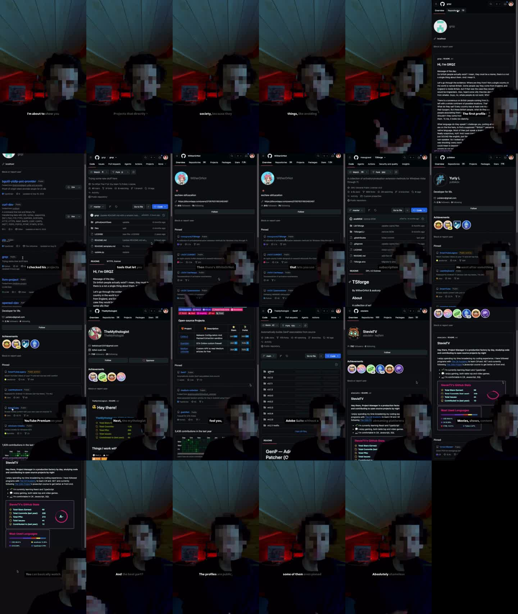

# מחקר עומק: @remy.engineering

נאסף ב-8.11.2026 דרך Apify. נמשכו הפרופיל, 40 רילס עם נתוני צפיות ותגובות מהפוסטים המובילים. הסרטון החזק ביותר הורד, תומלל ופורק לפריימים.

## 1. נתוני הפרופיל
| מדד | ערך |
|---|---|
| עוקבים | 1,286,313 |
| פוסטים | 112, כולם רילס |
| עוקב אחרי | 61 |
| ביו | `computer science and things like that` · מייל ב-proton · `Start Cybersecurity 👇` |
| קישורים בביו | בוטקמפ סייבר משלו (hackpath.dev), 2 אפליקציות (smog-ai, monarch), ערוץ יוטיוב |
| קצב העלאה | 2–3 רילס בשבוע |
| אורך ממוצע | כ-80 שניות (טווח 36–146) |
| אודיו | קול מקורי שלו בכל הסרטונים, בלי מוזיקה טרנדית |

**המודל העסקי:** תוכן חינמי שבונה קהל, ואחריו בוטקמפ בתשלום וקישורי שותפים לאפליקציות.

## 2. הרילס המובילים לפי צפיות (מתוך 40)
| צפיות | לייקים | תגובות | אורך | הפתיח |
|---|---|---|---|---|
| 7.6M | 336K | 1,550 | 63s | your internet provider can block websites. but sometimes, changing two numbers is enough |
| 4.8M | 221K | 1,288 | 95s | stop uploading your files to random online converters. |
| 4.5M | 277K | 1,638 | 49s | almost everyone in tech has heard of this website… but should you actually use it? |
| 3.5M | 101K | 416 | 76s | most people never check these google settings… |
| 3.1M | 156K | 3,045 | 116s | how to set up your own VPS tunnel |
| 2.9M | 106K | 1,039 | 36s | i can't believe people are actually using this software like this. |
| 2.9M | 77K | 632 | 146s | 3 signs your pc may already be hacked |
| 2.8M | 77K | 738 | 55s | change your passwords immediately if your email appears in a data breach. |
| 2.7M | 148K | 1,229 | 42s | how your webcam can be hacked. |
| 2.1M | 103K | 1,444 | 49s | you probably shouldn't know this tool… |

**הפוסט המוצמד, והחזק בעמוד:** "some of the most dangerous projects on github are completely public". יש לו 930K לייקים ו-4,447 תגובות, והוא באורך 68 שניות. הסקרייפר דילג על פוסטים מוצמדים, ולכן אין לנו את מספר הצפיות שלו. לפי יחס הלייקים לצפיות בשאר הפוסטים, ההערכה היא עשרות מיליוני צפיות.

**הפוסטים החלשים** (200K–400K צפיות) עוסקים בחדשות ובמעקב: עגלות סופר, עוגיות, "אירופה בוערת". נושאים מופשטים בלי כלי שאפשר לנסות בעצמך עובדים פחות טוב.

## 3. פירוק הסרטון החזק ביותר (68 שניות)
### תמלול מלא
> Warning, I'm about to show you some of the most dangerous projects on GitHub. Projects that directly threaten the balance of our society because they let you do absolutely terrifying things like avoiding certain subscriptions, and of course, everything is public. The first profile I found was GRQZ… Then there's WhiteOrNot… Then I found Yuliskov… YouTube Premium on your TV for free. Next, The Mythologist… Adobe Suite without a subscription. And finally, probably the streaming platforms' favorite project… And the best part? It's all public. The profiles are public, the projects are public, and some of them even pinned them directly on their GitHub. Absolutely shameless.

### מבנה

| זמן | מה רואים | מה קורה |
|---|---|---|
| 0–15s | פני היוצר (מפוקסלות), חדר חשוך עם תאורת LED אדומה | פתיח: "אזהרה, אני עומד להראות לכם…" בטון רציני-אירוני |
| 15–60s | הקלטת מסך של GitHub במצב כהה, והיוצר חתוך ברקע ירוק בפינה הימנית התחתונה | רשימה של 5 פריטים: פרופיל, ואז מה הוא עושה, ואז בדיחה קטנה |
| 60–68s | חזרה לפנים | סיום עם עוקץ: "Absolutely shameless" |

### הנוסחה
1. **פחד אירוני:** הוא מציג דברים מועילים כאילו הם "מסוכנים" ו"מאיימים על החברה". זה מושך הקלקות, והצופה מבין את הבדיחה.
2. **רשימה של 5:** כל פריט מקבל 8–10 שניות, ויש סיבה להמשיך לצפות עד הסוף.
3. **הוכחה ויזואלית:** פרופילים ופרויקטים אמיתיים על המסך, לא רק דיבור.
4. **אנונימיות כמיתוג:** הפנים מפוקסלות. זה יוצר מסתורין של "האקר", וחוסך את הצורך להופיע מול המצלמה.
5. **כתוביות מילה-מילה:** המילה המודגשת לבנה ושאר המשפט אפור, במרכז התחתון.
6. **הסיום מעודד תגובות:** הקהל שואל "איפה הלינק?" ו"זה עובד על טלוויזיה?". זה מנפח את מספר התגובות.

### מה הקהל כותב (מדגם תגובות)
- בקשות לקישור: "Send", "someone link me the YouTube thing".
- שאלות על התאמה למכשיר: "smart TV?", "iOS?", "Can we use this on a Mac?".
- צחוק על הבדיחה: "Dangerous? These are great!", "Thank you for keeping us safe!".

**המסקנה:** המעורבות מגיעה מבקשות ושאלות. כדאי לבנות את זה כמכוון, לדוגמה "כתבו 'שלח' ואשלח לכם את הרשימה בפרטי".

## 4. סיכון שחשוב לדעת עליו
חלק גדול מהתוכן החזק שלו נוגע בפיראטיות: Office, Adobe ו-YouTube Premium בלי תשלום, אתרי סטרימינג, ועקיפת חסימות ספקים, שבישראל מבוססות על צווי בית משפט. העתקה ישירה לעברית חושפת את העמוד להסרת פוסטים, לפגיעה בחשיפה ולתלונות.

**ההמלצה:** לשמור על הנוסחה (פחד אירוני, רשימה, הוכחה על המסך) ולמלא אותה בתוכן חוקי. יש מספיק כלים חינמיים וקוד פתוח "מסוכנים" שהם לגיטימיים לגמרי: תחליפים חינמיים ל-Office, Photoshop ו-Premiere, כלים לפרטיות וכלי OSINT להגנה עצמית. כך העמוד יכול לגדול לאורך זמן, וגם למכור בהמשך קורס או מוצר בלי סיכון.
